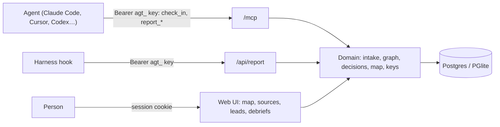

# AGINT - Architecture

One Next.js 16 app (App Router, TypeScript), Postgres in production and PGlite locally and in tests,
with Phean's shape: adapters (`/mcp`, `/api/report`, the web UI) on **one domain layer** that holds every
rule about tenants, permissions, validation, withholding and the lead lifecycle exactly once.



## Layers

- `src/server/domain` — services are `service(schema, run)`: they validate their own input and call
  `assertCan`. `intake.ts` (what agents call), `graph.ts` (nodes, edges, regrading, merging), `decisions.ts`
  (trace, dismiss, reopen), `map.ts` (read models), `keys.ts` (intake keys), `tenants.ts`.
- `src/server/mcp` — `serviceTool` turns a service into a tool; `guidance.ts` is the reporting guide
  every client receives at initialization. It is the whole "install".
- `src/app` — pages and route handlers only. Mutations are one `tenantAction(service)` line each.
- `src/lib` — client-safe vocabulary (`domain.ts`), identity normalization (`refs.ts`), secret
  withholding (`redact.ts`), signals (`signals.ts`), the map contract (`network-map.ts`) and the map's
  pure logic (`map-*.ts`).

## Who acts

`Ctx = { db, tenant, actor }`. A person's context comes from their session and their membership of the
network (a Better Auth organization). An agent's comes from its **intake key**: the key's row, never the
tool input, decides the network. One key can serve many agents; each identifies itself with `check_in`
and then names itself with the `agentId` it got back. An `agentId` from another key reads as missing.

| Action | owner / admin | member | agent |
| --- | --- | --- | --- |
| `network:read` (map, sources, leads, log) | yes | yes | no |
| `lead:decide` (trace, dismiss, reopen) | yes | yes | no |
| `key:manage` | yes | no | no |
| `network:report` | no | no | yes |

## Data model

| Table | |
| --- | --- |
| `intake_keys` | `agt_` keys, stored as SHA-256 hashes, revocable. |
| `entities` | Every node: `kind`, `ref` (normalized identity, unique per network and kind), `label`, `state`, `attributes`, a person's decision note. |
| `agents` | Sources. `fingerprint` (key, name, harness, host) makes `check_in` idempotent. Each has its node in `entities`. |
| `observations` | Edges with provenance: one row per (reporter, subject, relation, object), counted up on repeats, with `basis` and the latest three summaries. |
| `events` | The append-only debrief log: check-ins, activity, sightings, task changes, connections, corroborations and people's decisions. |

Every table carries `tenant_id` and composite foreign keys within the tenant, so an edge cannot point at
another network's node even if a service had a bug.

## The lead lifecycle

```
mentioned only ──▶ reference ──(someone sees it)──▶ lead ──(a 2nd independent source)──▶ corroborated
                                                     │                                       │
                                  agent connects ◀───┤                       person: traced / dismissed
                                  (becomes a source)
```

- `regrade` counts distinct reporter agents on a node's incoming edges, excluding the node's own agent
  and mentions: 0 → reference, 1 → lead, 2+ → corroborated. A person's call (traced, dismissed) and a
  source are never regraded. Reopening hands the node back to its reports.
- **Connecting a lead.** On a new `check_in`, agent leads whose ref is the agent's name, or whose
  harness and host match, become this source's node (others are merged into it): everything reporters
  said about it stays attached.
- **Identity.** `refs.ts` normalizes names so two reporters land on one node: repositories by host/path
  (`git@github.com:a/b.git` = `https://github.com/a/b`), services by hostname, credentials by
  `NAME@location` or a fingerprint (first hex of the value's SHA-256, computed by the agent).
- **Independence (PoC).** Two different agents count as independent. Later: weight by distinct host,
  principal and harness, and count agents quoting the same document once.

## Withholding

`withhold` replaces anything that looks like a secret (provider key formats, JWTs, private keys,
`KEY=value` pairs, credentials in URLs) with `[withheld]` in every string of every report before it is
stored, and the tool result tells the agent how many it withheld. The hook sends only metadata: paths,
hosts, MCP server and tool names, a command's program and subcommand.

## Later

Evidence-backed tracing (identity provider, CI and gateway logs), contradictions between a report and
evidence, interview triggers and a varied question bank, OAuth for agents (as in Phean), webhooks into
SIEM and gateways, and per-source freshness and consistency grades kept separate from claim grades.
